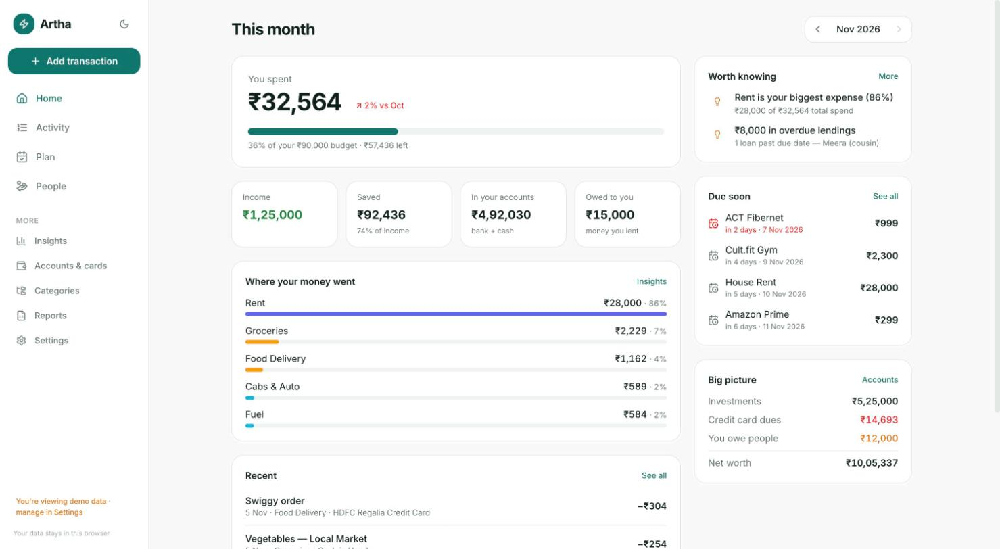
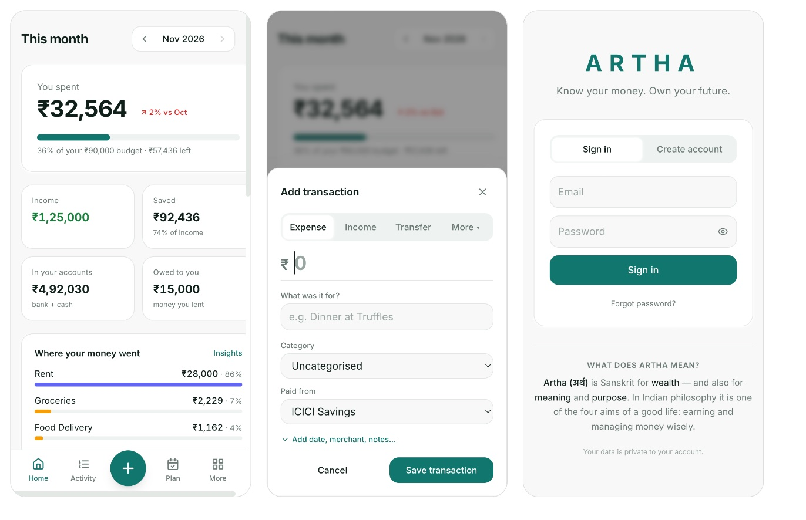
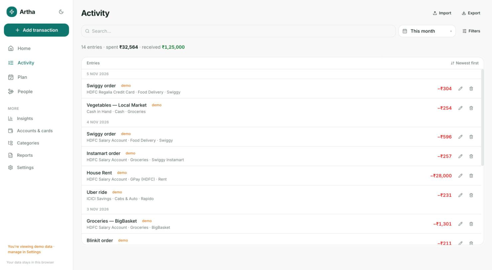
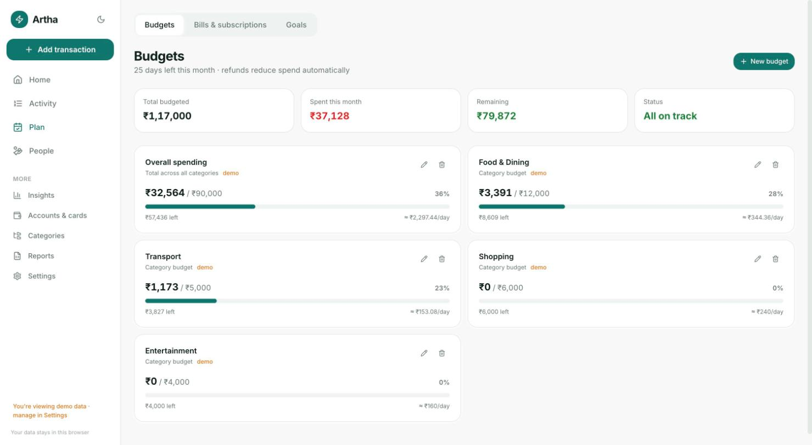
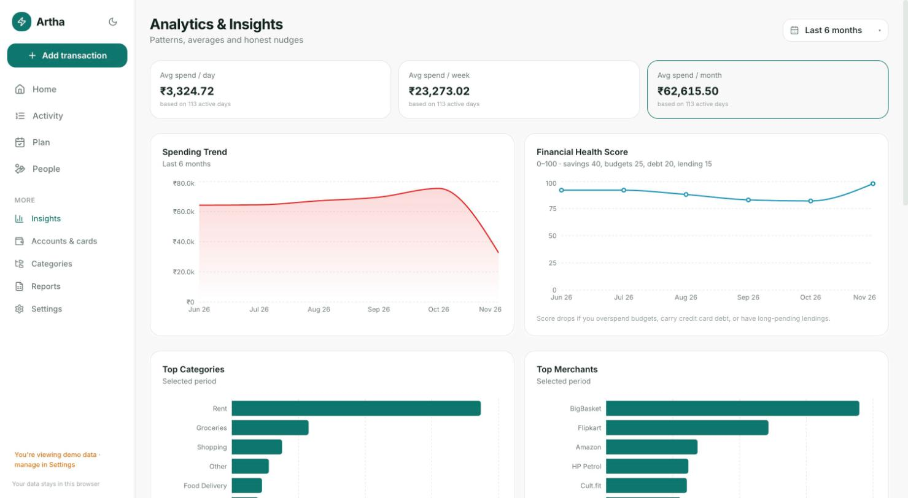
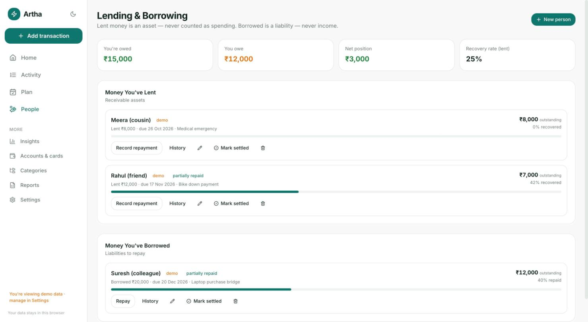

# Artha — Personal Finance & Expense Intelligence

**Know your money. Own your future.** · Live at **https://artha-self.vercel.app**

Artha (अर्थ — *wealth, meaning*) is a local-first personal finance app for India. It tracks
accounts, credit cards, transactions, budgets, subscriptions, lending/borrowing, goals and
income, then turns that data into analytics, plain-language insights and a monthly financial
health score — all in INR. Sign in to sync across your phone and laptop.

## Screenshots

> All screenshots use the built-in demo data — no real financial information.

**Home** — what you spent this month, key numbers, where the money went, tips and bills due soon


**On your phone** — Home, the quick add form, and the sign-in screen


| Activity | Plan (budgets) |
| --- | --- |
|  |  |
| **Insights** | **People (lending & borrowing)** |
|  |  |

## Quick start

```bash
npm install
npm run dev        # → http://localhost:3000
```

First run seeds default categories (Food & Dining, Transport, Housing & Utilities, …) and
payment methods (UPI, Cash, Debit Card). Open **Settings → Demo mode** to explore with
6 months of realistic sample data; wipe it any time. Your real data never mixes with demo rows.

```bash
npm run build      # production build
npx tsc --noEmit   # type check
npm test           # financial-rules + sync regression tests
```

## How it's organised

The app is built around four everyday sections, with everything else one tap away under **More**:

| Section | What you'll find |
| --- | --- |
| **Home** | What you spent this month vs budget/income, 4 key numbers, where the money went, up to 3 plain-language tips, bills due soon, recent activity. Switch months with ‹ › |
| **Activity** | Every transaction: search, date range, optional filters, CSV import/export |
| **Plan** | Tabs for Budgets, Bills & subscriptions, and Goals |
| **People** | Money you've lent and borrowed, with repayments |
| **More** | Insights, Accounts & cards, Categories, Reports, Settings |

Add a transaction from the **+** button (centre of the mobile tab bar, top of the desktop sidebar) or press
<kbd>N</kbd> anywhere. Only amount, description, category and account are shown by default; date, merchant,
payment method, tags and notes sit behind "Add date, merchant, notes…".

**Look & feel:** "Calm mint" palette — light by default with a matching dark mode (toggle in the sidebar or
More sheet). Colours live as CSS variables in `src/app/globals.css`.

## What's inside

| Area | Highlights |
| --- | --- |
| Home | Month snapshot, budget progress, top categories, tips, upcoming dues, net worth |
| Accounts | Bank / cash / wallet / investment accounts + credit cards with limit tracking |
| Transactions | Full CRUD, filters, CSV/Excel import wizard with duplicate detection |
| Categories | Hierarchy, need/want tags, fixed/variable flow, safe delete with merge |
| Budgets | Monthly overall + per-category budgets with progress and breach alerts |
| Subscriptions | Recurring costs, monthly/yearly burn, due-soon list |
| Lending | Money lent / borrowed, repayments, recovery rate, overdue tracking |
| Income | Sources, monthly trend, average |
| Analytics | Trends, category/merchant/payment-method splits, needs-vs-wants, insights |
| Goals | Savings goals with progress; investment txns can feed a goal |
| Reports | Monthly + category summaries, full transaction export (CSV) |
| Settings | Demo mode, health-score weights, backup, wipe |

## Financial rules (the opinionated core)

- **All money is stored as integer paise** — no floats anywhere.
- `transfer` and `cc_payment` move money between your own accounts — they are **never**
  income or expense.
- `lend` / `borrow` and their repayments are tracked separately — lending money out is **not**
  consumption, and receiving it back is **not** income.
- `refund` reduces the expense of its own category (netted, not separate income).
- `investment` is its own type, kept out of spending analytics.
- **Payment methods** (UPI app, card, cash) are lenses onto accounts — they never hold
  balances themselves.
- Every insight shows its calculation (`insight.calc`) — no black-box numbers.
- Demo data is clearly labelled and removable; real use starts from honest empty states.

## Cloud sync & deployment

- **Sign-in first:** the first screen anyone sees is a minimal ARTHA sign-in / sign-up page
  ("Know your money. Own your future."). The app only appears once you're signed in (`AuthGate`).
- **Supabase** (project `artha`, Mumbai) stores your data and handles sign-in.
  The browser keeps a working copy so the app is instant and works offline; changes are pushed
  automatically and the latest copy is pulled on open, focus and reconnect (`src/lib/sync.ts`).
  Demo data is never uploaded. Every table has Row Level Security — you can only read your own rows.
- **Vercel** hosts the site and redeploys on every push to `main`. Always use
  `artha-self.vercel.app` — other per-deploy `*.vercel.app` addresses redirect there, because
  browsers remember your login per address. You stay signed in until you press Sign out.
- **Installable app (PWA):** Settings → *Install Artha* (Android / desktop), or on iPhone Safari
  Share → *Add to Home Screen*. Opens full-screen with the Artha icon and works offline
  (`src/app/manifest.ts`, `public/sw.js`, icons in `public/icons/`).
- Setup: run `supabase/schema.sql` in the Supabase SQL editor, then set `NEXT_PUBLIC_SUPABASE_URL` and
  `NEXT_PUBLIC_SUPABASE_ANON_KEY` (the *publishable* key) in `.env.local` and in Vercel → Environment
  Variables. See `.env.example`. Add the Vercel URL under Supabase → Authentication → URL Configuration.
- Without those variables the app runs fully local and ungated, exactly as before.

## Tech

- **Next.js 14** (App Router) + **TypeScript** + **Tailwind CSS**
- **Dexie** (IndexedDB) + `dexie-react-hooks` — local-first storage, live queries
- **Recharts**, **date-fns**, **papaparse** + **xlsx**, **lucide-react**, **next-themes**

## Data & architecture

Everything lives in the browser's IndexedDB today — no server, no account, works offline.
The data layer (`src/lib/db.ts`) is isolated behind CRUD functions, and
[`supabase/schema.sql`](supabase/schema.sql) mirrors every table (with Postgres RLS
policies) as the future cloud-sync target. Swapping Dexie for Supabase means touching only
the db/hooks layer — pages and analytics stay pure.

## Project layout

```
src/
  app/            # routes: home (/), plan (budgets/subscriptions/goals tabs), accounts, transactions, categories,
                  # budgets, subscriptions, lending, income, analytics, goals,
                  # reports, settings
  components/     # UI primitives, charts, TxnForm, modals
  lib/
    types.ts      # canonical entity shapes
    db.ts         # Dexie schema, CRUD, settings, seedDefaults
    finance.ts    # balances, totals, budgets, loans, net worth (pure)
    analytics.ts  # trends, breakdowns, splits (pure)
    insights.ts   # insight engine (pure)
    healthScore.ts# monthly 0–100 score: savings/budget/debt/lending
    csv.ts        # import wizard + exports
    demo.ts       # demo seed / clear / wipe
    hooks.ts      # dexie-react-hooks live queries
supabase/
  schema.sql      # future Postgres schema + RLS (not wired up yet)
```

## Roadmap

- [x] Supabase auth + sync
- [ ] Recurring transaction auto-creation from subscriptions
- [x] PWA / offline install
- [x] Vercel deployment

## License

[MIT](LICENSE) © 2026 Abhilash Dontula

Artha is built on open-source libraries (Next.js, React, Supabase JS, Dexie, Recharts,
Tailwind CSS, date-fns, lucide-react, papaparse, SheetJS and others), each under its own
permissive licence (MIT, Apache-2.0 or ISC). See each package in `node_modules` for its
licence text.

